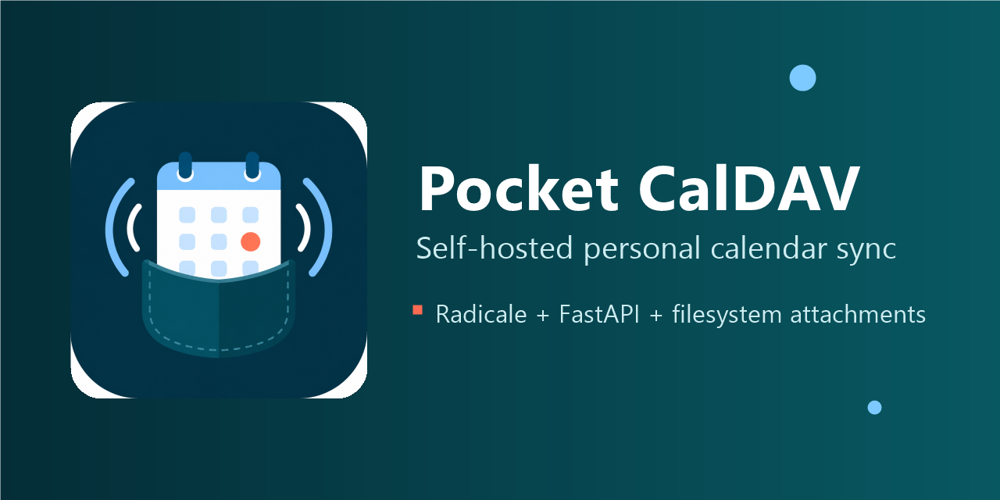

# Pocket CalDAV



Pocket CalDAV is a small self-hosted CalDAV server for personal calendars.
It keeps deployment simple by combining:

- Radicale for standards-compliant CalDAV serving.
- FastAPI management endpoints under `/api/*`.
- Filesystem-backed attachment storage with automatic cleanup.

It is designed for Apple Calendar and for Android devices that include a native CalDAV account provider. Many stock Android builds do not include native CalDAV; Pocket CalDAV stays standards-compliant but cannot add missing OS sync-provider support on the phone.

The project is intentionally compact: one Python server file, one Dockerfile,
and persistent filesystem storage that is easy to back up.

## Quick Start on Windows

```powershell
cd D:\projects\pocket-caldav
py -m venv .venv
.\.venv\Scripts\Activate.ps1
python -m pip install --upgrade pip
python -m pip install -r requirements.txt
python server.py cli
python server.py
```

The first run creates:

- `data\users.json` for CalDAV usernames and passwords. It starts empty unless `CALDAV_USERS` is set.
- `data\api_key.txt` with a generated management API key.
- `data\settings.json` with attachment cleanup settings.
- `data\collections` for Radicale calendar data.
- `data\attachments` for uploaded event attachments.

Use the guided CLI to create the first user and calendar. CalDAV passwords are stored as bcrypt htpasswd hashes. For real deployment, set explicit environment variables or manage credentials carefully on the server.

## Quick Start with Docker

Copy the environment template and edit the public domain:

```bash
cp .env.example .env
nano .env
```

Start the service:

```bash
docker compose up -d --build
docker compose logs -f caldav
```

By default, Compose binds the service to `127.0.0.1:5232` on the host and stores all server data in the named volume `caldav-data`. Put Caddy or nginx in front of it for HTTPS, then set `PUBLIC_BASE_URL` in `.env` to that external HTTPS origin.

Minimal Caddy example:

```text
calendar.example.com {
    request_body {
        max_size 30MB
    }
    reverse_proxy 127.0.0.1:5232
}
```

Run the guided CLI inside the container when you need to create calendars or change saved cleanup settings:

```bash
docker compose exec caldav python server.py cli
```

If `CALDAV_API_KEY` is empty, the server generates one on first startup and stores it in the data volume. Read it with:

```bash
docker compose exec caldav cat /data/api_key.txt
```

If `CALDAV_USERS` is empty, create CalDAV users with the guided CLI. You can still set `CALDAV_API_KEY` or `CALDAV_USERS` in `.env` when you want fixed values managed by environment variables.

For a direct non-proxied local test, set `HOST_BIND=0.0.0.0` in `.env` and restart the container. Do not expose plain HTTP publicly with real CalDAV passwords.

## Guided Server CLI

Run this on the server:

```powershell
python server.py cli
```

The menu can:

- Show configured users, calendars, and cleanup settings.
- Create or update a CalDAV user.
- Delete an old user by either migrating that user's calendars and managed attachments to another user or permanently deleting them.
- Create a calendar for a user.
- Set the attachment cleanup TTL and cleanup interval.
- Run attachment cleanup immediately.

`python server.py` and `python server.py serve` both start the CalDAV server.

## Configuration

For a normal Docker deployment behind Caddy/nginx, the only value users must edit is `PUBLIC_BASE_URL`.

Docker Compose reads these values from `.env`:

| Variable | User must set? | Default/example | Purpose |
| --- | --- | --- | --- |
| `PUBLIC_BASE_URL` | Yes, for production | `https://calendar.example.com` | External HTTPS origin written into generated attachment URLs. Set this to your real calendar domain. |
| `HOST_BIND` | Usually no | `127.0.0.1` | Host bind address for the Docker port mapping. Keep `127.0.0.1` when using Caddy/nginx on the same server. |
| `HOST_PORT` | Usually no | `5232` | Host-side port used by Caddy/nginx to reach the container. Change only if `5232` is already used locally. |
| `ALLOWED_HOSTS` | No | empty | Optional comma-separated Host allowlist. Empty derives the public host from `PUBLIC_BASE_URL` and also allows local health checks. |
| `CALDAV_API_KEY` | No | empty | Leave empty to auto-generate `/data/api_key.txt`. Fixed values must be at least 32 characters. |
| `CALDAV_USERS` | No | empty | Leave empty and create users with `python server.py cli`. Set only if you want users/passwords managed by `.env`. |
| `ATTACHMENT_TTL_DAYS` | No | `365` | Attachment cleanup TTL. If set, it overrides the value saved by the CLI. |
| `CLEANUP_INTERVAL_SECONDS` | No | `3600` | Attachment cleanup interval. If set, it overrides the value saved by the CLI. |
| `MAX_ICS_BYTES` | No | `1048576` | Maximum management API event body size. |
| `MAX_ATTACHMENT_BYTES` | No | `26214400` | Maximum stored attachment size. |
| `MAX_REQUEST_BYTES` | No | `31457280` | Default request body limit for other routes, including direct CalDAV traffic, `/api/batch`, and imports. |
| `DEFAULT_TIMEZONE` | No | `UTC` | IANA zone used for floating times and all-day events in event listings and attachment cleanup, e.g. `Europe/Berlin`. |

The Compose file sets these internal container values automatically; users normally should not add them to `.env`:

| Variable | Compose value | Purpose |
| --- | --- | --- |
| `DATA_DIR` | `/data` | Persistent server data inside the Docker volume. |
| `HOST` | `0.0.0.0` | Container listen address. The host exposure is controlled by `HOST_BIND`. |
| `PORT` | `5232` | Container listen port. The host exposure is controlled by `HOST_PORT`. |

Without Docker, the script reads these environment variables directly:

| Variable | Required? | Default | Notes |
| --- | --- | --- | --- |
| `DATA_DIR` | No | `./data` | Set this to a backed-up production path if running outside Docker. |
| `HOST` | No | `127.0.0.1` | Keep loopback behind a reverse proxy; use `0.0.0.0` only for direct local testing. |
| `PORT` | No | `5232` | Application listen port. |
| `PUBLIC_BASE_URL` | Recommended for production | request base URL | Set to the external HTTPS origin so attachment URLs are stable and client-visible. |
| `ALLOWED_HOSTS` | No | derived from `PUBLIC_BASE_URL` | Optional comma-separated Host allowlist. |
| `CALDAV_API_KEY` | No | generated in `data/api_key.txt` | Optional fixed management API key, at least 32 characters. |
| `CALDAV_USERS` | No | empty | Optional fixed users. Prefer the guided CLI for user setup. |
| `ATTACHMENT_TTL_DAYS` | No | saved setting or `365` | Overrides `data/settings.json` when present. |
| `CLEANUP_INTERVAL_SECONDS` | No | saved setting or `3600` | Overrides `data/settings.json` when present. |
| `MAX_ICS_BYTES` | No | `1048576` | Maximum management API event body size. |
| `MAX_ATTACHMENT_BYTES` | No | `26214400` | Maximum stored attachment size. |
| `MAX_REQUEST_BYTES` | No | `31457280` | Default request body limit for other routes, `/api/batch`, and imports. |
| `DEFAULT_TIMEZONE` | No | `UTC` | IANA zone for floating times and all-day events. |

`CALDAV_USERS` accepts either comma-separated `user:password` pairs or JSON:

```powershell
$env:CALDAV_USERS = "main:replace-main-password"
$env:CALDAV_USERS = '{"main":"main-password"}'
```

When `HOST=0.0.0.0` or `HOST=::`, `PUBLIC_BASE_URL` is required unless `ALLOW_REQUEST_BASE_URL=true` is explicitly set for local testing. `PUBLIC_BASE_URL` must use HTTPS unless `ALLOW_INSECURE_PUBLIC_BASE_URL=true` is explicitly set.

Run a single process/worker for this script. Radicale and the management API share the same filesystem storage and coordinate with Radicale's storage lock.

## Calendar URLs

Local development base URL:

```text
http://127.0.0.1:5232
```

One-user, multiple-calendar layout:

```text
http://127.0.0.1:5232/main/work/
http://127.0.0.1:5232/main/personal/
http://127.0.0.1:5232/main/shared/
```

Separate-user layout:

```text
http://127.0.0.1:5232/work/default/
http://127.0.0.1:5232/personal/default/
http://127.0.0.1:5232/shared/default/
```

No default calendars are created automatically. Create the users and calendars you actually need with `python server.py cli` or the management API.

For Apple Calendar on iOS/macOS:

1. Open Calendar account settings.
2. Add a CalDAV account.
3. Server: `https://calendar.example.com` or `http://127.0.0.1:5232` for local testing.
4. Username/password: one of the users from `data\users.json` or `CALDAV_USERS`.
5. If manual URL entry is available, use one of the full calendar URLs above.

For Android:

1. Use the built-in CalDAV account provider if your Android/OEM build includes one.
2. Server: `https://calendar.example.com` or the full calendar URL.
3. Username/password: matching CalDAV credentials.

Use HTTPS in production. CalDAV uses Basic authentication here, so cleartext HTTP exposes credentials on the network.

## Management API

All `/api/*` calls require:

```text
X-API-Key: <value from CALDAV_API_KEY or data\api_key.txt>
```

Create a calendar:

```powershell
Invoke-RestMethod `
  -Method Post `
  -Uri http://127.0.0.1:5232/api/calendars `
  -Headers @{ "X-API-Key" = "<api-key>" } `
  -ContentType "application/json" `
  -Body '{"owner":"main","calendar":"work","display_name":"Work"}'
```

Create or update an event:

```powershell
$ics = @"
BEGIN:VCALENDAR
VERSION:2.0
PRODID:-//Pocket CalDAV//EN
BEGIN:VEVENT
UID:event-001
DTSTAMP:20260526T090000Z
DTSTART:20260527T100000Z
DTEND:20260527T110000Z
SUMMARY:Example Event
END:VEVENT
END:VCALENDAR
"@

Invoke-RestMethod `
  -Method Put `
  -Uri http://127.0.0.1:5232/api/calendars/main/work/event-001 `
  -Headers @{ "X-API-Key" = "<api-key>" } `
  -ContentType "text/calendar" `
  -Body $ics
```

Upload an attachment:

```powershell
curl.exe `
  -X POST `
  -H "X-API-Key: <api-key>" `
  -F "file=@C:\path\to\file.pdf" `
  http://127.0.0.1:5232/api/calendars/main/work/event-001/attachments
```

Delete an event:

```powershell
Invoke-RestMethod `
  -Method Delete `
  -Uri http://127.0.0.1:5232/api/calendars/main/work/event-001 `
  -Headers @{ "X-API-Key" = "<api-key>" }
```

Manually run attachment cleanup (see [Attachment cleanup](#attachment-cleanup)):

```powershell
Invoke-RestMethod `
  -Method Post `
  -Uri "http://127.0.0.1:5232/api/cleanup?dry_run=true" `
  -Headers @{ "X-API-Key" = "<api-key>" }
```

The full, machine-readable contract is served at `/openapi.json` and `/docs`.
The examples below use `curl` with `H='X-API-Key: <api-key>'` and `B=http://127.0.0.1:5232`.

### For AI agents

The API is designed to be driven by agents. Point the agent at `GET /api/guide` (plain Markdown, no key needed): it lists the conventions and one call per common task. `/openapi.json` has stable, readable `operationId`s (`create_event`, `patch_event`, `search_events`, ...) for tool generation.

**JSON events** — no iCalendar needed. The server writes valid ICS (DTSTAMP, VTIMEZONE, line folding, UTC `UNTIL`):

```bash
curl -X POST -H "$H" -H 'Content-Type: application/json' "$B/api/calendars/main/personal/events" -d '{
  "summary": "Standup", "start": "2026-11-02T09:00", "duration": "PT15M", "timezone": "Europe/Berlin",
  "rrule": "FREQ=WEEKLY;BYDAY=MO;UNTIL=2027-06-30", "alarms": [{"minutes_before": 10}]
}'
curl -H "$H" "$B/api/calendars/main/personal/<uid>?format=json"
curl -X PATCH -H "$H" -H 'If-Match: "<etag>"' -H 'Content-Type: application/json' \
  "$B/api/calendars/main/personal/<uid>" -d '{"start": "2026-11-02T10:00", "add_exdates": ["2026-12-21T10:00"]}'
```

- Fields: `summary` (alias `title`), `start`, `end` or `duration`, `timezone`, `location`, `description`, `url`, `status`, `busy`, `categories`, `rrule`, `exdates`, `alarms`; PATCH also takes `add_exdates`. A date (`2026-11-27`) makes an all-day event; a date-time without offset is wall-clock time in `timezone`. Ends are exclusive. Unknown fields are rejected, so typos surface instead of being ignored.
- Create refuses duplicates: an event with the same title (case and spacing ignored) and start in the same calendar returns `409 duplicate_event` with the existing copy in `error.details.duplicates`. Use `on_duplicate: "return_existing"` for idempotent retries or `"allow"` for intentional copies. A UID is generated unless you pass `uid`.
- PATCH changes only the fields you send (`null` removes one). Moving `start` keeps the duration and moves EXDATEs and overrides with the series. Properties the JSON view does not model are preserved and listed in `other_properties`. `SEQUENCE`, `DTSTAMP`, and `LAST-MODIFIED` are maintained for CalDAV clients.
- Every write returns the stored `event` and its `etag`; `dry_run=true` previews it.

**Errors** keep FastAPI's `detail` and add a structured object:

```json
{"detail": "...", "error": {"code": "duplicate_event", "message": "...", "hint": "what to do next", "retryable": false, "details": {...}}}
```

Branch on `error.code` (for example `event_not_found`, `calendar_not_found`, `duplicate_event`, `uid_exists`, `precondition_failed`, `invalid_field`, `invalid_event`, `invalid_request`, `cursor_mismatch`, `token_expired`, `unknown_endpoint`). A `412` includes `details.current_etag`.

**Search across calendars**: `GET /api/events?q=...&from=...&to=...` uses the same filters and paging as a single calendar, and `GET /api/events?uid=<uid>` finds every copy of an event in any calendar. `GET /api/calendars` lists calendars with their event counts.

### Listing and searching events

```bash
curl -H "$H" "$B/api/calendars/main/personal/events?from=2026-11-01T00:00:00Z&to=2026-12-01T00:00:00Z"
curl -H "$H" "$B/api/calendars/main/personal/events?q=dentist"
curl -H "$H" "$B/api/calendars/main/personal/events?from=2026-11-01T00:00:00%2B01:00&to=2026-12-01T00:00:00%2B01:00&expand_recurrence=true"
```

- `from` (inclusive) and `to` (exclusive) must carry a timezone offset. Filtering uses overlap semantics (`start < to AND end > from`), so long-running and all-day events that started before the window are included. Events without `DTEND` last one day (all-day) or are instants (date-time).
- Without `expand_recurrence`, a recurring series is one item (with its `rrule`) and matches when any instance overlaps. With `expand_recurrence=true` (requires `to`), each instance is an item with its `recurrence_id`; overrides are flagged with `is_override`.
- `q` is a case-insensitive substring match on `SUMMARY`, `LOCATION`, and `DESCRIPTION`, useful for duplicate checks.
- Floating times and all-day dates are interpreted in `tz` (default `DEFAULT_TIMEZONE`). `start_utc`/`end_utc` are normalised; `dtstart`/`dtend` show the stored value.
- `rrule` is reported with its parts in canonical order (`FREQ` first, then alphabetical) so it can be compared reliably.
- Pages hold up to `limit` items (default 200, max 1000). Follow `next_cursor` (also sent as a `Link: rel="next"` header) until `truncated` is `false`. Paging is keyset-based: on an unchanged calendar a full sweep returns every matching item exactly once, and `total` is the number of matches when the page was produced. An event edited during a sweep can move across the cursor and be seen twice or not at all, so use the change feed to catch up on edits. A cursor is only valid for the same query.
- Series whose recurrence rule can never be expanded (for example `INTERVAL=0`, written by some client) are reported in `invalid_items` instead of stalling the request.
- Every item names its `owner` and `calendar`. `invalid_items` lists files that could not be parsed, instead of hiding them.
- `GET .../events` lists the calendar; an event whose UID is literally `events` can still be written, deleted, and exported but not read with a point `GET`.

### ETags and conditional requests

`GET`, `PUT`, attachment uploads, and listings report an `ETag` per event (a hash of the stored bytes; it is not the CalDAV `getetag`). `GET` and `PUT` also send `Last-Modified`.

```bash
# Only overwrite if nobody changed the event since we read it (412 otherwise, nothing written).
curl -X PUT -H "$H" -H 'If-Match: "3aebd1b9..."' --data-binary @event.ics "$B/api/calendars/main/personal/event-001"
# Only create; fail with 412 if the UID already exists.
curl -X PUT -H "$H" -H 'If-None-Match: *' --data-binary @event.ics "$B/api/calendars/main/personal/event-001"
# Delete only the version we inspected.
curl -X DELETE -H "$H" -H 'If-Match: "3aebd1b9..."' "$B/api/calendars/main/personal/event-001"
# Revalidate a cached copy: 304 when unchanged.
curl -H "$H" -H 'If-None-Match: "3aebd1b9..."' "$B/api/calendars/main/personal/event-001"
```

A `412` response carries the current `ETag`. `PUT ...?dry_run=true` validates, evaluates preconditions, and returns the normalised event and its future ETag without writing.

Point lookups also find events whose file name differs from their UID (as created by CalDAV clients), and a `PUT` updates that file instead of creating a duplicate.

`PUT` rejects (400) input it cannot store faithfully: properties the parser would otherwise silently drop (for example an unparseable `DTEND` or `RRULE`), recurrence rules that never advance (`INTERVAL=0`), and events Radicale itself could not load, which CalDAV clients would never see. Radicale's limit on instances of a finite series is raised from 10,000 to 100,000, so long series such as a daily event for 30 years are accepted.

### Batch changes

```bash
curl -X POST -H "$H" -H 'Content-Type: application/json' "$B/api/batch" -d '{
  "operations": [
    {"op": "put", "owner": "main", "calendar": "personal", "uid": "a", "ics": "BEGIN:VCALENDAR...", "if_none_match": "*"},
    {"op": "delete", "owner": "main", "calendar": "personal", "uid": "b", "if_match": "\"7f...\""}
  ]
}'
```

Batches are always atomic: every operation is validated and its precondition checked first, then either all of them are applied or none is (a failed write is rolled back). Operations run in order, so a later operation sees earlier ones on the same UID. On failure the HTTP status is that of the first failing operation, `failed_index` points at it, `applied` is `false`, and every result has an `outcome` (`failed` or `not_applied`). `"dry_run": true` evaluates everything without writing. Up to 500 operations per batch.

### Change feed and history

```bash
curl -H "$H" "$B/api/changes?owner=main&calendar=personal"            # from the beginning
curl -H "$H" "$B/api/changes?since=<next_token>&owner=main"           # only what changed since
curl -H "$H" "$B/api/calendars/main/personal/event-001/history"
```

Every creation, update, and deletion is recorded in `data/journal.sqlite3` with its `source`: `api`, `batch`, `import`, `attachment`, `cleanup`, `calendar-delete`, or `external`. Changes made by CalDAV clients, the CLI, or manual edits are detected when the feed (or any management write to that calendar) runs, and recorded as `external`. Calendars that existed before the journal was introduced appear once as `created` with source `baseline`. A deleted event shows a `deleted` entry in its history, while an event that never existed has an empty history. A token from a different journal (for example after restoring a backup without it) returns `410`, which means you should resync from scratch.

### Attachments

```bash
curl -H "$H" "$B/api/calendars/main/personal/event-001/attachments"                 # list
curl -H "$H" -OJ "$B/api/calendars/main/personal/event-001/attachments/<id>"         # download
curl -X DELETE -H "$H" "$B/api/calendars/main/personal/event-001/attachments/<id>"   # delete
```

The list shows uploaded (managed) attachments with `size`, `content_type`, `created_at`, plus any other `ATTACH` references in the event. `in_event` and `file_present` expose drift between the ICS and the stored files. Deleting removes the file, the index record, and the matching `ATTACH` property in one step and returns the event's new ETag (`If-Match` is honoured).

### Calendars

```bash
curl -X PATCH -H "$H" -H 'Content-Type: application/json' -d '{"display_name": "Household"}' "$B/api/calendars/shared/shared"
curl -X DELETE -H "$H" "$B/api/calendars/main/test"              # 409 if it still has events
curl -X DELETE -H "$H" "$B/api/calendars/main/test?force=true"   # also deletes its events and attachments
```

Creating, renaming, or writing to a calendar keeps properties set by CalDAV clients (such as colour).

### Export, backup, and import

```bash
curl -H "$H" -o personal.ics "$B/api/export?owner=main&calendar=personal"
curl -H "$H" -o backup.zip   "$B/api/export?format=zip"                      # everything
curl -H "$H" -o main.zip     "$B/api/export?format=zip&owner=main&include_attachments=false"
curl -X POST -H "$H" --data-binary @personal.ics "$B/api/calendars/main/personal/import?mode=skip_existing"
```

- `format=ics` returns one `VCALENDAR` with every component and the needed `VTIMEZONE`s; `ATTACH` properties keep their URIs. The `Content-Digest` header carries its SHA-256 and `X-Event-Count` the number of events.
- `format=zip` contains, per calendar, byte-exact event files, the calendar properties, and a `calendar.ics` bundle, plus attachment files and a `manifest.json` with SHA-256 digests to verify the backup.
- Restore a zip with `POST /api/restore` (body: the archive, `Content-Type: application/zip`). Every file is checked against the SHA-256 in `manifest.json` before anything is written; event files come back byte-for-byte (including copies that share a UID), together with calendar properties and the attachments in the archive. Calendars that already have events are refused with 409 unless `replace=true`, which makes them identical to the backup. `owner`/`calendar` restore a subset and `dry_run=true` reports what would change. The archive must fit in `MAX_REQUEST_BYTES` (and your proxy's body limit).
- Import splits a bundle by UID (a series keeps its overrides) and applies it atomically. A bundle in which a UID appears as more than one event is refused with `duplicate_uids`; restore the zip instead. `mode=upsert` (default) replaces existing UIDs, `mode=create` fails with 412 if any UID exists, and `mode=skip_existing` leaves existing UIDs untouched. `dry_run=true` previews. Non-`VEVENT` components are reported in `skipped_components`.

### Limits

There is no server-side rate limiting, so no rate-limit headers are sent; put limits in the reverse proxy if you need them. Every list endpoint pages the same way (`limit`, an opaque cursor or token, `truncated`, and a `Link: rel="next"` header while more is available). Recurrence expansion is capped at 50,000 instances per request (422 beyond that).

### Validation

```bash
curl -X POST -H "$H" -H 'Content-Type: application/json' "$B/api/validate" -d '{"ics": "BEGIN:VCALENDAR..."}'
```

Returns `valid`, `errors`, and `warnings` (each with a `code`, a `message`, and a line number where one applies). Checks include malformed or unfolded lines, unbalanced components, missing `UID`/`DTSTAMP`/`DTSTART`, `DTEND`/`DURATION` conflicts, unparseable `RRULE`s, `TZID`s without a `VTIMEZONE`, `EXDATE`s that match no occurrence or have the wrong value type, and whether CalDAV clients could load the event. `PUT` only enforces what it cannot store faithfully, so run this before writing.

### CalDAV clients

`GET /api/dav-info` describes how clients connect. The management `X-API-Key` is not accepted by CalDAV endpoints: Apple Calendar, DAVx⁵, and other clients use HTTP Basic auth with a per-user password, and each user can only access calendars under `/<user>/`. Radicale supports `calendar-query`, `calendar-multiget`, and `sync-collection` reports for those credentials.

### Attachment cleanup

The server deletes managed attachments automatically every `CLEANUP_INTERVAL_SECONDS`. An attachment is deleted when its event has ended (for a recurring series, after its last instance; series without an end never expire this way), when its event no longer exists, or when it is older than `ATTACHMENT_TTL_DAYS`. The file, its index record, and the `ATTACH` reference are removed together; events are never deleted. Running it is idempotent.

`POST /api/cleanup` only runs that job early. Because it deletes files, a bare call is refused with 400: pass `dry_run=true` to list what would be deleted and why, or `confirm=true` to delete.

## Production Notes

- Put the service behind an HTTPS reverse proxy such as Caddy or nginx.
- Set `PUBLIC_BASE_URL` to the external HTTPS origin so event attachment URLs are usable from clients.
- Keep the reverse proxy request body limit at or below `MAX_REQUEST_BYTES`.
- In Docker, back up the `caldav-data` volume. Without Docker, store `data` somewhere backed up and protected by filesystem permissions. Before destructive changes through the API, take `GET /api/export?format=zip` and check its `manifest.json`.
- Keep `CALDAV_API_KEY` and CalDAV passwords secret.
- Start with one worker process. If you need multi-process scaling, move management writes behind a single writer or use Radicale-native operations instead of direct filesystem writes.

## Development

```bash
python -m pip install -r requirements-dev.txt
python -m pytest
```

The tests start the app against a temporary data directory and never touch `data/`.

## License

Pocket CalDAV is released under the MIT License. See [LICENSE](LICENSE).
